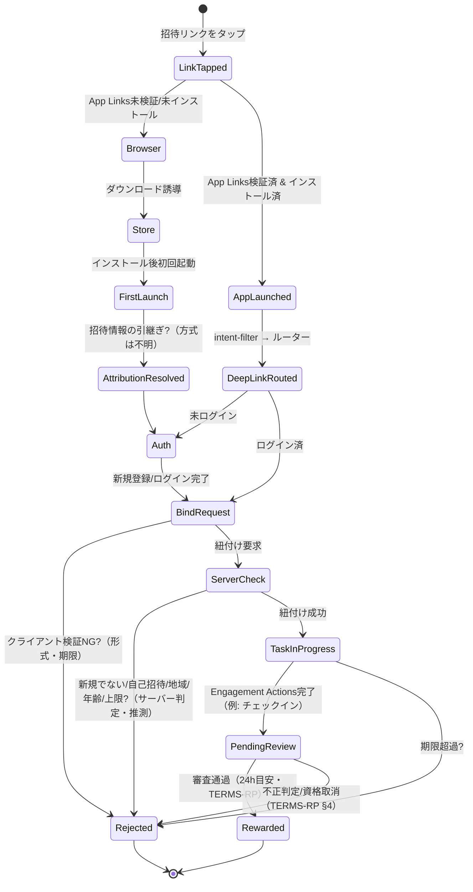

# 04 招待関連の状態遷移（仮説版 v0）

凡例: 実線＝規約/観測に根拠あり予定、`?` 付き＝**推測（サーバー側条件を含む）**。観測後に証拠IDを付与して更新する。

## 模擬システムとの対応
| 図の状態 | `mock_invite.State` |
|---|---|
| DeepLinkRouted / AttributionResolved | `LINK_OPENED`（`open_link`） |
| ServerCheck 成功 | `BOUND` → `TASK_IN_PROGRESS`（`bind`） |
| PendingReview / Rewarded / Rejected | 同名（`evaluate`） |

模擬システムは「インストール前後の引継ぎ方式」「不正判定」を**再現しない**（不明かつ再現の必要なし）。
